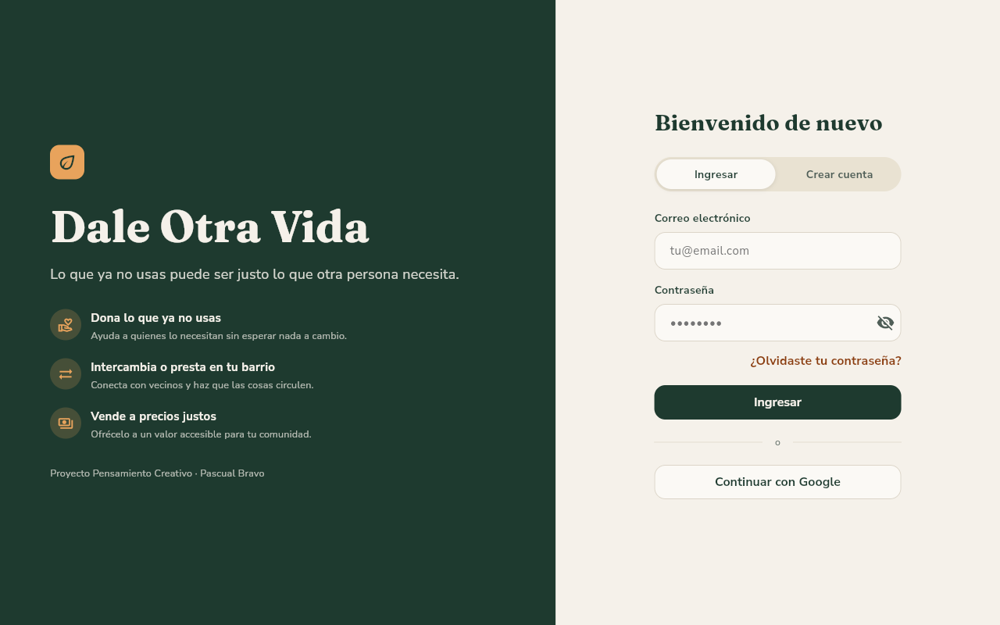
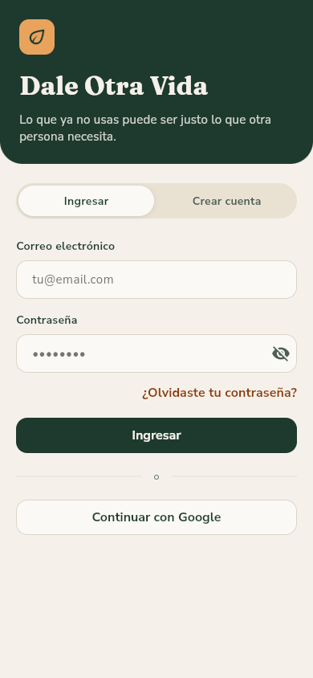

# Dale Otra Vida

A community app to **donate, exchange, sell or lend** food, clothes and everyday objects with
neighbors in Medellín, so things you no longer use get a second life.

Built in one week as a university project (Pensamiento Creativo, Institución Universitaria
Pascual Bravo) by a solo developer. It runs on Android, iOS and the web from a single codebase.

**Live demo:** https://dale-otra-vida.serverpod.space (installable as a PWA)

[](https://github.com/Marlon-Trujillo-Jaramillo/dale-otra-vida/actions/workflows/tests.yml)
[](https://github.com/Marlon-Trujillo-Jaramillo/dale-otra-vida/actions/workflows/analyze.yml)
[](https://github.com/Marlon-Trujillo-Jaramillo/dale-otra-vida/actions/workflows/format.yml)


<p align="center">
  
  &nbsp;
  
</p>

## Engineering highlights

- **End-to-end type safety.** Models are declared once in `.spy.yaml`; Serverpod generates the
  PostgreSQL tables, migrations, server classes and a typed Dart client.
- **Concurrency-safe reservations.** Accepting a request locks the listing row
  (`SELECT … FOR UPDATE`), so a double tap or two devices accepting at once can never reserve the
  same item twice.
- **Real-time chat over WebSockets.** Messages are persisted first, then published on a channel;
  clients reconnect and catch up after a dropped connection.
- **Image pipeline.** Photos are compressed on the device (max 1440 px, quality 78), uploaded
  straight to storage through a signed URL (never through the API server), verified by the
  server, and cached on the client with `cached_network_image`.
- **Privacy by design.** Locations are rounded on the server, so the map only shows an
  approximate zone (~100 m), never an address.
- **Push notifications** with Firebase Cloud Messaging, plus an in-app notification center.
- **Responsive and installable.** Bottom bar on phones, navigation rail on tablets, split views
  on desktop web, and a PWA install flow (including manual steps on iPhone).
- **Quality gates.** 32 automated tests (server integration tests + Flutter tests) and CI for
  `dart analyze`, `dart format` and tests on every push.
- **Cloud deployment.** One command (`scloud deploy`) builds and ships the server, the web app
  and the database migrations to Serverpod Cloud. See
  [docs/arquitectura-tecnica.md](docs/arquitectura-tecnica.md) for the full technical design.

## Features

- **Sign-in** with email and verification code, or with Google.
- **Feed of nearby listings** with type and category filters, search, and a "closest first"
  sort.
- **Map** of the listings in the visible area. Markers show an approximate zone (~100 m),
  never an exact address.
- **Publish** with up to 5 photos, compressed on the device before upload. Fields depend on
  the type: expiry date for food, price for sales, return date for loans, and what you want in
  return for exchanges.
- **"Lo quiero" requests.** The owner accepts one and the listing is reserved for that person;
  the other requests are rejected automatically. Concurrent accepts are serialized with
  database row locks.
- **Real-time chat** over WebSockets, with a safety banner, quick replies and a safe meeting
  point proposal.
- **Trust.** After a delivery both sides rate each other. Profiles show the rating, reviews
  and number of deliveries, and members or listings can be reported.
- **Notifications** for new requests, reservations, messages, deliveries, reviews and food
  that is about to expire.
- **Responsive layouts.** Phones get a bottom bar, tablets a navigation rail, and desktop web
  a top bar with split views (conversation list + chat, list + map).

## Tech stack

| Layer | Technology |
|---|---|
| App | Flutter 3.44 (Dart), Material 3, bundled Fraunces + Nunito Sans fonts |
| Backend | [Serverpod](https://serverpod.dev) 4 (Dart): typed endpoints, generated client, streams |
| Database | PostgreSQL through the Serverpod ORM, with migrations |
| Auth | `serverpod_auth_idp` (email + Google) |
| Files | Serverpod storage with direct uploads |
| Maps | `flutter_map` + OpenStreetMap tiles |

```
dale_otra_vida_server/   Endpoints, models (.spy.yaml), migrations, integration tests
dale_otra_vida_client/   Client generated by Serverpod (do not edit)
dale_otra_vida_flutter/  The app: lib/core (design system) + lib/features/*
docs/                    Design system and the spec of each feature
```

## How it works

1. **Shared data models.** Models are defined once in `.spy.yaml` files. Serverpod generates
   the database tables, the server classes and a typed Dart client, so the app calls
   `client.listing.feed(...)` like a local function.
2. **Business rules live on the server.** The server checks permissions, validates input,
   rounds locations, locks rows and creates notifications; the app only presents the results.
3. **Real-time chat.** Each message is stored first and then published on a channel. Clients
   subscribed through a WebSocket stream receive it instantly, and they reconnect and catch up
   after a dropped connection.

## Running locally

Requires the Flutter SDK and the Serverpod CLI (`dart pub global activate serverpod_cli`).

```bash
cd dale_otra_vida_server
serverpod start          # starts the database, the server (8080) and the app
dart test                # server integration tests (uses an embedded PostgreSQL)

cd ../dale_otra_vida_flutter
flutter test             # app unit and widget tests
```

Secrets (`config/passwords.yaml`, `config/google_client_secret.json`) are not part of the
repository.

## AI-assisted engineering

Built in one week by one developer working with two AI coding agents, each with a defined role:

- **Claude Code plans, designs and verifies**: data model, auth and security, architecture and the final review of every change.
- **OpenCode executes well-specified tasks**, routed to the cheapest model that can do each one right (mechanical edits, implementing a written spec, or a stronger model for tricky multi-file logic). The routing table lives in [`CLAUDE.md`](CLAUDE.md).
- **Every delegated task has an exact scope, acceptance checks and no commits**: Claude reviews the diff and runs `dart analyze`, `dart format` and the tests before anything is committed.
- **Written specs first**: each day's work started as a task spec in [`docs/tasks/`](docs/tasks), and the agents worked from it.
- **39 versioned skills** ([`.opencode/skills/`](.opencode/skills)) give the agents up-to-date guidance for Serverpod (endpoints, streams, migrations, file uploads, caching, testing) and Flutter (architecture, responsive layouts, routing, tests).
- **Serverpod MCP**: the agents create and apply migrations, hot-reload and read server and app logs through the Serverpod MCP server instead of guessing ([`AGENTS.md`](AGENTS.md)).
- **Performance review**: a 30-point performance checklist was analyzed item by item, and the result (what was done, what wasn't and why) is documented in [docs/arquitectura-tecnica.md §16](docs/arquitectura-tecnica.md).

## Credits

Team: Daniela Cardona, Nicolás Puerta and Marlon Trujillo Jaramillo.
Fonts: Fraunces and Nunito Sans (SIL Open Font License). Map data © OpenStreetMap
contributors.
