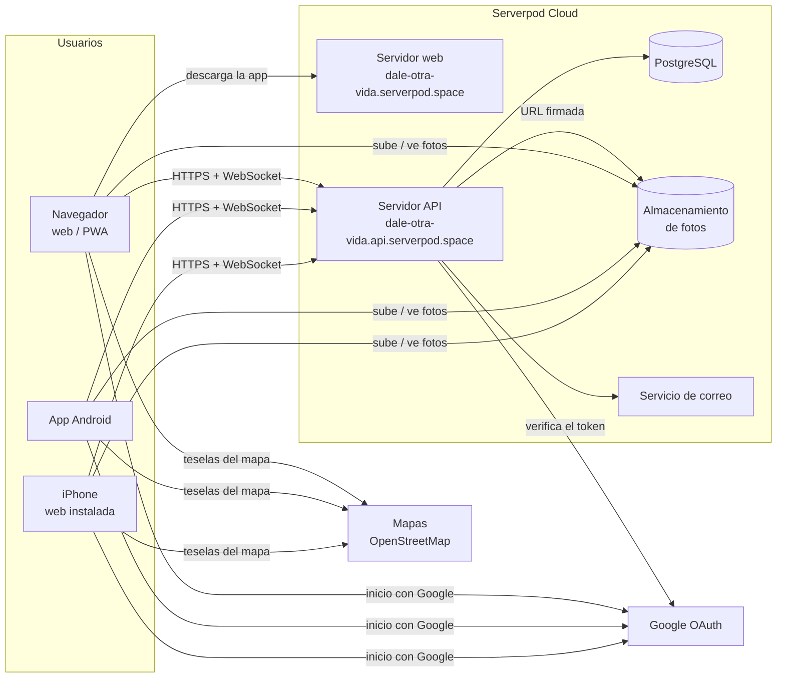
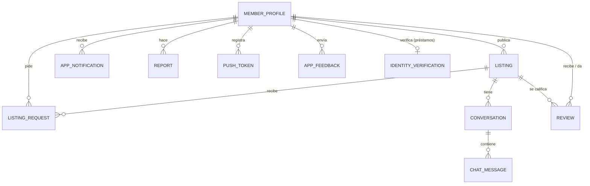
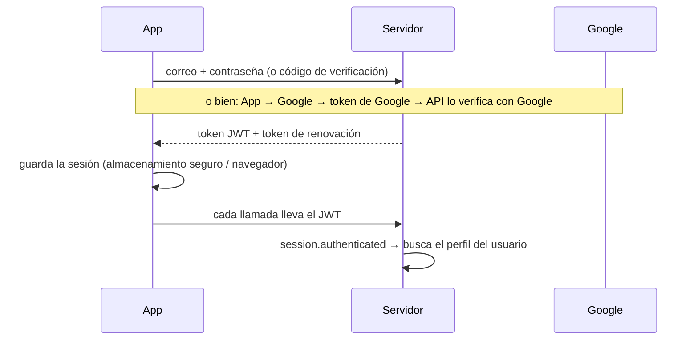
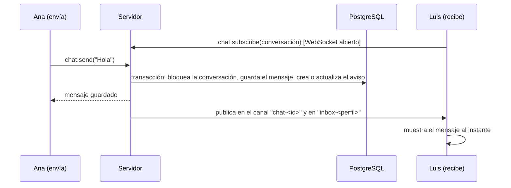
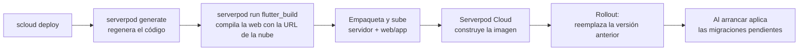
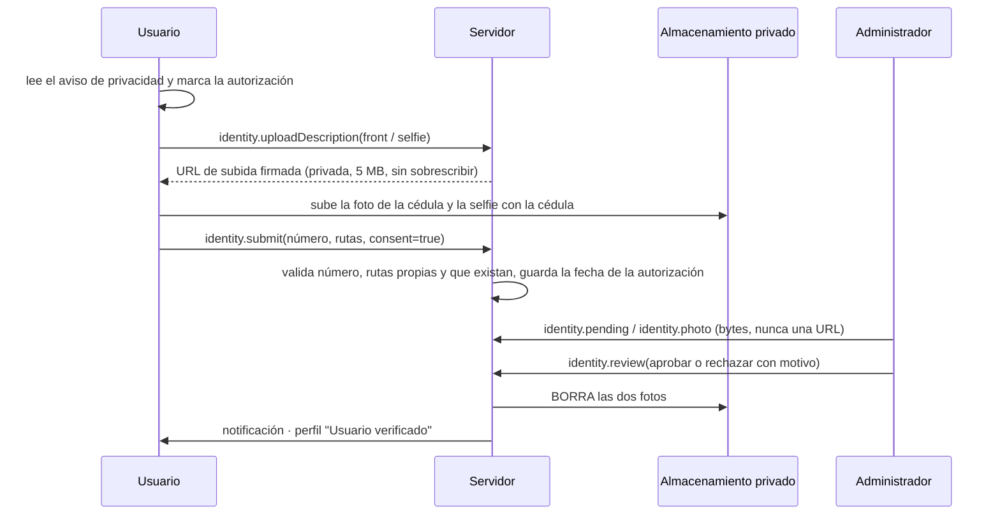

# Dale Otra Vida · Arquitectura técnica

Documento técnico de cómo está construida la aplicación: el frontend, el backend, dónde está alojada, qué servicios usa y cómo se comunican las partes.

> **Resumen en una línea:** una sola base de código en **Flutter** (web, Android e iOS) habla con un servidor en **Serverpod** (Dart). El servidor guarda todo en **PostgreSQL** y está publicado en **Serverpod Cloud**. Las dos partes comparten los mismos modelos de datos, porque Serverpod genera el código del cliente a partir del servidor.

---

## Índice

1. [Vista general](#1-vista-general)
2. [Tecnologías](#2-tecnologías)
3. [Estructura del repositorio](#3-estructura-del-repositorio)
4. [Frontend (Flutter)](#4-frontend-flutter)
5. [Backend (Serverpod)](#5-backend-serverpod)
6. [Cómo se comunican frontend y backend](#6-cómo-se-comunican-frontend-y-backend)
7. [Alojamiento y despliegue](#7-alojamiento-y-despliegue)
8. [Servicios externos](#8-servicios-externos)
9. [Flujos completos, paso a paso](#9-flujos-completos-paso-a-paso)
10. [Seguridad y privacidad](#10-seguridad-y-privacidad)
11. [Pruebas](#11-pruebas)
12. [Desarrollo local](#12-desarrollo-local)
13. [Limitaciones y pendientes](#13-limitaciones-y-pendientes)
14. [Préstamos con garantías](#14-préstamos-con-garantías)
15. [Verificación de identidad (cédula)](#15-verificación-de-identidad-cédula)
16. [Rendimiento: qué se hizo, qué no y por qué](#16-rendimiento-qué-se-hizo-qué-no-y-por-qué)
17. [Política de datos (Ley 1581)](#17-política-de-datos-ley-1581)

---

## 1. Vista general



**Las piezas:**

| Pieza | Qué es | Dónde vive |
|---|---|---|
| **App** | Flutter: una sola base de código para web, Android e iOS | Navegador, celular |
| **Web** | La misma app compilada a JavaScript | La sirve el servidor web de Serverpod Cloud |
| **API** | Servidor Serverpod en Dart, con la lógica de negocio | Serverpod Cloud |
| **Base de datos** | PostgreSQL | Serverpod Cloud (administrada) |
| **Fotos** | Almacenamiento de archivos | Serverpod Cloud (bucket público) |
| **Correo** | Envío de códigos de verificación | Servicio de correo de Serverpod Cloud |

---

## 2. Tecnologías

| Capa | Tecnología | Versión |
|---|---|---|
| Lenguaje (todo) | Dart | 3.12 |
| Frontend | Flutter, Material 3 | 3.44 |
| Backend | Serverpod | 4.0.4 |
| Base de datos | PostgreSQL (ORM de Serverpod, con migraciones) | 16 |
| Autenticación | `serverpod_auth_idp` (correo + Google) | 4.0.4 |
| Mapas | `flutter_map` + `latlong2` + OpenStreetMap | 8.3 |
| Fotos | `image_picker` + `flutter_image_compress` + `cached_network_image` | — |
| Ubicación | `geolocator` | 14 |
| Notificaciones push | Firebase Cloud Messaging (`firebase_messaging`) | 17 (sin activar, ver §13) |
| Tipografías | Fraunces (títulos) + Nunito Sans (texto), incluidas en la app | — |
| Alojamiento | Serverpod Cloud | CLI `scloud` 1.2 |

**¿Por qué Dart en las dos partes?** Con el mismo lenguaje arriba y abajo, Serverpod puede **generar el cliente automáticamente**. Una clase como `Listing` existe igual en el servidor y en la app, y llamar al servidor es como llamar a una función local.

---

## 3. Estructura del repositorio

Es un *workspace* de Dart con tres paquetes:

```
dale_otra_vida/
├── dale_otra_vida_server/     ← Backend (Serverpod)
│   ├── lib/server.dart          arranque: auth, almacenamiento, servidor web
│   ├── lib/src/<feature>/       un endpoint por funcionalidad
│   ├── lib/src/models/          modelos de datos (*.spy.yaml)
│   ├── lib/src/generated/       código GENERADO (no se edita a mano)
│   ├── migrations/              migraciones SQL de la base de datos
│   ├── config/                  configuración por entorno + passwords.yaml (no va a git)
│   ├── test/integration/        pruebas con base de datos real
│   ├── tool/                    scripts de desarrollo (dev_start.sh, phone_run.sh)
│   └── scloud.yaml              configuración de Serverpod Cloud
│
├── dale_otra_vida_client/     ← Cliente GENERADO por Serverpod (no se edita)
│
├── dale_otra_vida_flutter/    ← Frontend (Flutter)
│   ├── lib/main.dart            punto de entrada
│   ├── lib/client.dart          conexión con el servidor + Google
│   ├── lib/core/                sistema de diseño, utilidades, widgets compartidos
│   ├── lib/features/<feature>/  una carpeta por pantalla o funcionalidad
│   ├── web/                     index.html, manifest (PWA), auth.html, service worker
│   ├── android/  ios/           proyectos nativos
│   ├── assets/icon/             fuente de los íconos de la app
│   └── test/                    pruebas unitarias y de widgets
│
└── docs/                      ← Especificaciones y este documento
```

---

## 4. Frontend (Flutter)

### 4.1 Organización del código

```
lib/
├── core/                         lo compartido por toda la app
│   ├── theme/                    tokens de diseño: colores, tipografía, espaciado
│   ├── widgets/                  botones, campos, tarjetas, estados vacíos, avatares…
│   ├── layout/breakpoints.dart   tamaños de pantalla (compact / medium / expanded)
│   ├── models/                   textos e íconos de cada enum (tipo, categoría…)
│   ├── photos.dart               tomar, comprimir y subir fotos
│   ├── location.dart             ubicación del usuario
│   ├── install/                  "Instalar app" en la web (PWA)
│   └── push/                     notificaciones push (Firebase)
│
└── features/                     una carpeta por funcionalidad
    ├── auth/          inicio de sesión y registro (correo / Google)
    ├── onboarding/    completar el perfil la primera vez
    ├── shell/         esqueleto: barra de navegación según el tamaño de pantalla
    ├── home/          inicio: buscador, filtros, categorías, impacto, listado
    ├── map/           mapa con las publicaciones de la zona
    ├── listing/       detalle de una publicación
    ├── publish/       publicar y editar
    ├── requests/      "Lo quiero" y mis solicitudes
    ├── chat/          conversaciones y chat en vivo
    ├── notifications/ avisos dentro de la app
    ├── reviews/       calificar (incluida la calificación obligatoria)
    ├── reports/       reportar usuario o publicación
    ├── profile/       perfil propio y de otros, edición, foto
    ├── feedback/      "Danos tu opinión"
    ├── install/       aviso para instalar la app
    └── push/          tarjeta "Activar notificaciones"
```

**Patrón por pantalla:**
- `*_screen.dart` dibuja la pantalla.
- `*_logic.dart` tiene **funciones puras**, como el estado de los botones o el formato de los textos. Se prueban sin interfaz.
- `*_controller.dart` maneja estado con `ChangeNotifier` cuando hace falta, por ejemplo la paginación del inicio.

La gestión de estado es la de Flutter (`StatefulWidget`, `ChangeNotifier`, `ListenableBuilder`), sin librerías externas.

### 4.2 Diseño adaptable (responsive)

Una misma app se adapta a tres tamaños (`lib/core/layout/breakpoints.dart`):

| Tamaño | Ancho | Navegación | Ejemplos |
|---|---|---|---|
| **compact** (celular) | < 600 px | Barra inferior: Inicio · Mensajes · **(+)** · Avisos · Perfil | Lista de una columna |
| **medium** (tableta) | 600–1023 px | Riel lateral | Cuadrícula de 2–3 columnas |
| **expanded** (escritorio) | ≥ 1024 px | Barra superior con "Publicar" | Vistas divididas: lista + chat, lista + mapa |

La cuadrícula de publicaciones usa un `SliverGridDelegate` propio que calcula columnas y alto según el ancho disponible. Una prueba recorre **12 anchos de pantalla en 8 pantallas** para que nada se desborde.

### 4.3 Sistema de diseño

Definido en `docs/design-system.md` e implementado en `lib/core/theme/`:
- **Colores:** verde bosque `#1E3A2F` (principal), naranja `#E8A35C` (acento, botón +, logo) y crema `#F5F1EA` (fondo).
- **Tipografía:** Fraunces para títulos y Nunito Sans para texto. Las fuentes van **dentro de la app** (`google_fonts/`), así no se descargan en cada visita.
- **Componentes compartidos:** `AppPrimaryButton`, `AppTextField`, `ListingGridCard`, `EmptyState`, `memberAvatar`…

### 4.4 Fotos

1. El usuario elige **"Tomar foto"** o **"Elegir de la galería"**. En celulares la elección aparece también en la web; en computador se abre directo el selector de archivos.
2. En Android e iOS la foto se **comprime en el dispositivo** a un máximo de 1440 px y calidad 78 antes de subirla.
3. La app pide al servidor una **URL de subida firmada**, sube la foto **directo al almacenamiento** sin pasar por el servidor, y luego el servidor **verifica** que el archivo exista.

### 4.5 Web instalable (PWA)

- `web/manifest.json` define el nombre, el ícono y los colores para que la web se instale como app.
- `web/index.html` incluye un pequeño script (`window.dovInstall`) que:
  - guarda el aviso de instalación de Chrome (`beforeinstallprompt`) para mostrarlo cuando el usuario toque **"Instalar"**;
  - detecta si es iPhone, donde la instalación es manual con Compartir → Agregar a pantalla de inicio, y muestra los pasos.
- Dart lo llama con `dart:js_interop` (`lib/core/install/`). En Android e iOS nativos esas funciones no hacen nada.

### 4.6 Navegación (go_router)

Cada pantalla tiene su propia dirección (`lib/app/navigation.dart`), así que el botón atrás del navegador y el de Android recorren el mismo camino que hizo el usuario, y una publicación se puede abrir desde un enlace.

| Dirección | Pantalla |
|---|---|
| `/` | Entrada de la web: muestra Inicio y es donde "atrás" pregunta *"¿Salir de Dale Otra Vida?"* |
| `/inicio`, `/mensajes`, `/perfil` | Pestañas (un solo esqueleto: cambiar de pestaña no recarga nada) |
| `/mapa`, `/avisos`, `/publicar`, `/solicitudes`, `/editar-perfil` | Pantallas principales |
| `/publicacion/:id`, `/chat/:id`, `/usuario/:id` | Detalles; si se abren desde un enlace, se cargan por id |
| `/identidad`, `/identidad/revisar` | Verificación de cédula |

**Reglas del botón atrás:**
- **Desde cualquier sección, atrás vuelve hacia Inicio.** Entre pestañas la dirección se *reemplaza* (`Router.neglect`), así que el historial queda siempre "Inicio → sección".
- **En Inicio, atrás pregunta antes de salir.** En la web, la app abre en `/` y, al primer toque, registra `/inicio` como un paso aparte. Chrome solo respeta los pasos que nacen de un toque. Al volver de `/inicio` a `/`, aparece la ventana.
- **Cerrar una pantalla en la web** con la flecha de la app usa el atrás del navegador (`closeScreen`, `_WebBackScope`). Si no, go_router registraría el regreso como una visita nueva.
- **Abierta desde un enlace,** sin nada detrás, una pantalla vuelve a Inicio en vez de sacar al usuario.
- **En la app de Android,** el botón atrás pasa por el router: cierra la pantalla de encima; en otra pestaña vuelve a Inicio; en Inicio pregunta.

Las direcciones son limpias, sin `#` (`usePathUrlStrategy`). El servidor entrega la app para cualquier dirección (`FlutterRoute`), así que recargar `/mapa` funciona.

**Cómo se comprobó:** `tool/routing_check.dart` arma la navegación real sin servidor. Se recorrió en Chrome con tamaño de celular: pestañas, mapa, atrás, la ventana de salir y sus dos botones.

### 4.7 Íconos

Se generan con `flutter_launcher_icons` a partir de `assets/icon/` (la hoja del logo sobre naranja) para Android (con ícono adaptable), iOS y la web.

---

## 5. Backend (Serverpod)

### 5.1 Qué es Serverpod

Es un framework de backend en Dart. A partir de los **modelos** (`*.spy.yaml`) y los **endpoints** (clases Dart), genera:
- las tablas de la base de datos y sus migraciones;
- las clases del servidor, con acceso tipado a la base de datos (ORM);
- **el cliente para la app** (`dale_otra_vida_client`), con los mismos modelos y un método por cada endpoint.

### 5.2 Arranque (`lib/server.dart`)

Al iniciar, el servidor:
1. Configura la **autenticación**:
   - tokens **JWT**;
   - inicio con **correo + código**, enviado por el servicio de correo de Serverpod Cloud;
   - inicio con **Google**. Si la clave de Google está mal configurada, Google se desactiva y el servidor arranca igual.
2. Configura el **almacenamiento de fotos**: público y privado, en Serverpod Cloud o en la base de datos cuando se corre en local.
3. Si existe la carpeta `web/app`, la **sirve como sitio web** (`FlutterRoute`). Ahí queda la app web compilada.
4. Aplica las **migraciones pendientes** y empieza a escuchar.

### 5.3 Endpoints

Cada endpoint es una clase en `lib/src/<feature>/`. **Todos** exigen sesión iniciada (`requireLogin`). El endpoint de ejemplo de la plantilla (`greeting`) se eliminó.

| Endpoint | Métodos | Para qué |
|---|---|---|
| `profile` | `me`, `saveMe`, `updateMe`, `avatarUploadDescription`, `setAvatar`, `byId`, `publicProfile` | Perfil propio y de otros, foto de perfil |
| `listing` | `feed`, `inArea`, `byId`, `mine`, `create`, `update`, `updateStatus`, **`closeLoan`**, `photoUploadDescription`, `verifyPhotoUpload` | Publicaciones: listado, mapa, crear, editar, cambiar estado, cerrar un préstamo |
| `request` | `create`, `forListing`, `mine`, `accept`, `reject`, `cancel` | "Lo quiero" y su ciclo de vida |
| `chat` | `conversations`, `conversation`, `messages`, `send`, `markRead`, `unreadTotal`, `typing`, **`subscribe`** *(stream)*, **`inbox`** *(stream)*, **`typingEvents`** *(stream)* | Chat en tiempo real y "escribiendo…" |
| `review` | `create`, `pending`, `forMember` | Calificaciones y entregas pendientes de calificar |
| `notification` | `list`, `unreadCount`, `markRead`, `markAllRead` | Avisos dentro de la app |
| `report` | `create` | Reportar usuario o publicación |
| `stats` | `community` | Contador de impacto de la comunidad |
| `feedback` | `send` | Opiniones de los usuarios de prueba |
| `push` | `enabled`, `register`, `unregister` | Dispositivos para notificaciones push |
| `identity` | `mine`, `uploadDescription`, `submit` · administradores: `isAdmin`, `pending`, `photo`, `review` | Verificación de identidad con cédula (ver §15) |

### 5.4 Modelo de datos



| Tabla | Qué guarda |
|---|---|
| `member_profile` | Nombre, barrio, ubicación aproximada, foto, tipo de cuenta, calificación promedio, número de reseñas y de entregas |
| `listing` | Publicación: título, descripción, tipo (donar / intercambiar / vender / prestar), categoría, estado, fotos, precio, vencimiento, zona. En préstamos además: fecha de devolución, garantía, recargo por día, condiciones y cómo terminó (devuelto / no devuelto) |
| `listing_request` | Solicitudes "Lo quiero": pendiente / aceptada / rechazada / cancelada. En préstamos, cuándo se aceptaron las condiciones |
| `conversation` | Un chat por publicación y solicitante, con el último mensaje y su fecha |
| `chat_message` | Mensajes: texto, tipo (normal, punto seguro, sistema), leído |
| `review` | Calificación de 1 a 5 y comentario, una por persona por entrega |
| `app_notification` | Avisos internos: nueva solicitud, aceptada, mensaje, entrega, reseña, comida por vencer… |
| `report` | Reportes de usuarios o publicaciones |
| `push_token` | Dispositivos que aceptaron notificaciones push |
| `app_feedback` | Opiniones enviadas desde "Danos tu opinión" |
| `identity_verification` | Verificación de cédula: estado, número, rutas privadas de las fotos (se vacían al revisar), fecha de la autorización y quién revisó |

Además hay **modelos sin tabla** que solo viajan al cliente: `ListingView`, `ConversationView`, `RequestView`, `PublicProfileView`, `ReviewView`, `PendingReview`, `CommunityImpact`, `IdentityState`, `IdentityReviewItem`, y `TypingEvent` (que solo viaja por el canal en vivo). Combinan datos de varias tablas en una sola respuesta.

**Estados de una publicación:** `available` → `reserved` → `delivered`, o `withdrawn` si el dueño la retira.

### 5.5 Reglas de negocio importantes (todas en el servidor)

La app **solo muestra**: el servidor decide qué está permitido. Así nadie puede saltarse una regla modificando la app.

- **Validación de todo lo que entra:** largos de texto, precios solo en ventas, fechas futuras, entre 1 y 5 fotos, coordenadas válidas.
- **Privacidad de la ubicación:** las coordenadas se guardan redondeadas a unos 100 m, y la ubicación de un usuario **nunca** se envía a otro. Las publicaciones les llegan a los demás movidas al **centro de una zona de ~1,1 km** (una cuadrícula de 0,01°), con la distancia redondeada a medio kilómetro. El dueño ve su ubicación real. El mapa dibuja un círculo por zona con el nombre del barrio, no un pin por casa.
- **Concurrencia:** toda acción sobre una publicación **bloquea primero su fila** en la base de datos (`SELECT … FOR UPDATE`). Si dos personas aceptan o piden al mismo tiempo, se procesan una tras otra. Al aceptar una solicitud, las demás se rechazan automáticamente.
- **Entrega:** al marcar "Entregado" se suma una entrega al dueño, se avisa al otro y se publica un mensaje de sistema en el chat.
- **Reseñas:** solo después de una entrega (en préstamos, solo cuando el dueño lo cierra), solo entre los dos participantes y una sola vez por persona. El promedio se recalcula al guardar.
- **Préstamos:** quien pide debe tener la identidad verificada y aceptar las condiciones (ver §14 y §15).
- **Notificaciones de chat agrupadas:** una sola por conversación, que se actualiza con cada mensaje nuevo.
- **Recordatorio de comida por vencer:** se revisa cuando la app consulta el contador de avisos, así que no hace falta un proceso programado.
- **Límites contra spam:** 30 mensajes por minuto, 20 publicaciones y 30 solicitudes por día, 20 opiniones por día y reportes duplicados bloqueados por 24 horas.

---

## 6. Cómo se comunican frontend y backend

### 6.1 El cliente generado

Serverpod genera `dale_otra_vida_client` y la app lo usa así:

```dart
// lib/client.dart
client = Client(serverUrl)                       // https://dale-otra-vida.api.serverpod.space/
  ..connectivityMonitor = FlutterConnectivityMonitor()
  ..authSessionManager = FlutterAuthSessionManager();

// En cualquier pantalla:
final listings = await client.listing.feed(category: Category.food, limit: 20, offset: 0);
await client.chat.send(conversationId, 'Hola, ¿sigue disponible?');
```

No hay URLs escritas a mano ni JSON armado a mano: los parámetros y las respuestas son **clases de Dart tipadas**. Si el servidor cambia un modelo, la app deja de compilar hasta adaptarse, y así se evitan errores en producción.

### 6.2 Protocolo

| Tipo de llamada | Transporte | Se usa para |
|---|---|---|
| Llamadas normales (`Future`) | **HTTPS** POST, con el cuerpo en JSON (lo serializa Serverpod) | Casi todo: listar, crear, aceptar, calificar… |
| Streams (`Stream`) | **WebSocket** persistente | Chat en vivo: `chat.subscribe` (una conversación) y `chat.inbox` (todas) |

### 6.3 Autenticación en cada llamada



- **Correo:**
  - registro con código de verificación enviado por correo;
  - recuperación de contraseña con código;
  - los intentos tienen límite.
- **Google:**
  - en Android con el inicio de sesión nativo de Google;
  - en la web con el flujo de **redirección OAuth (PKCE)**: abre la ventana de Google, que vuelve a `web/auth.html`, y esa página le devuelve el código a la app.
  - El servidor intercambia el código y verifica la cuenta con Google.

### 6.4 Chat en tiempo real



- El mensaje **se guarda primero** y se publica en el canal **después** de confirmar la transacción. Así nunca llega un mensaje que no quedó guardado.
- Si se cae la conexión, la app **se reconecta** a los 3 segundos y **recupera** los mensajes que se perdió.
- **Envío optimista:** el mensaje aparece en tu chat apenas tocas enviar, con un reloj ⏱. Cuando el servidor lo confirma, el reloj cambia por la hora. Si falla, el texto vuelve al campo para reintentar. Así no se siente la espera de la red (ver §16).
- **"Escribiendo…":** mientras escribes, la app avisa al servidor como mucho cada 3 segundos (`chat.typing`). El servidor lo reenvía por el canal `typing-<id>`, sin guardar nada. El otro ve tres puntos animados durante 4 segundos, o hasta que llega tu mensaje.
- Los contadores de no leídos (los numeritos de Mensajes y Avisos) se consultan cada cierto tiempo y cuando llega algo por el inbox.

---

## 7. Alojamiento y despliegue

### 7.1 Serverpod Cloud

| Recurso | Dirección |
|---|---|
| **App web (la que se comparte)** | https://dale-otra-vida.serverpod.space |
| API | https://dale-otra-vida.api.serverpod.space |
| Insights (monitoreo de Serverpod) | https://dale-otra-vida.insights.serverpod.space |

Serverpod Cloud administra el **servidor**, la **base de datos PostgreSQL**, el **almacenamiento de fotos**, el **correo**, los **certificados HTTPS** y las **contraseñas internas**. El proyecto se llama `dale-otra-vida`.

### 7.2 Cómo se publica una versión

```
scloud deploy
```



- Los pasos previos están en `scloud.yaml` (`pre_deploy`).
- La web se compila con `--dart-define=SERVER_URL=https://dale-otra-vida.api.serverpod.space/` (script `flutter_build` en `dale_otra_vida_server/pubspec.yaml`) y se copia a `web/app`, que sirve el propio servidor.
- **No se suben:** `config/passwords.yaml`, `config/google_client_secret.json` ni los archivos de configuración por entorno (ver `.scloudignore`). Serverpod Cloud maneja su propia configuración.
- Una publicación tarda entre 4 y 5 minutos.

### 7.3 Secretos en la nube

Se cargan con `scloud password set <nombre> …` y el servidor los lee con `getPassword`:

| Secreto | Origen | Uso |
|---|---|---|
| `database`, `serviceSecret`, peppers de autenticación, clave JWT, clave de correo | **Automáticos** (los genera la plataforma) | Base de datos, Insights, autenticación, correo |
| `googleClientSecret` | Cargado a mano (JSON del cliente web de Google) | Inicio con Google |
| `firebaseServiceAccount` | Cargado a mano (pendiente) | Enviar notificaciones push |
| `identityAdmins` | Cargado a mano: correos separados por comas | Quién puede revisar verificaciones de identidad |

### 7.4 App de Android

Se compila con `flutter build apk --release --dart-define=SERVER_URL=https://dale-otra-vida.api.serverpod.space/` y se instala directamente con el APK. Todavía no está en Google Play. Su identificador es `co.daleotravida.app`.

---

## 8. Servicios externos

| Servicio | Para qué | Costo |
|---|---|---|
| **Serverpod Cloud** | Servidor, base de datos, fotos, correo, HTTPS | Prueba gratis de 1 mes; después es de pago |
| **Google OAuth** (Google Cloud) | Inicio de sesión con Google. Clientes OAuth: web ("Servidor Serverpod"), Android e iOS | Gratis |
| **OpenStreetMap** | Teselas del mapa (`tile.openstreetmap.org`), con la atribución visible | Gratis (uso moderado) |
| **gstatic.com** (Google) | El motor gráfico de Flutter Web (CanvasKit) y Firebase JS | Gratis |
| **Firebase Cloud Messaging** | Notificaciones push (código listo, falta crear el proyecto) | Gratis |

---

## 9. Flujos completos, paso a paso

### Publicar algo
1. **Publicar (+)** → se elige el tipo, la categoría y el estado, y se escriben el título y la descripción.
2. Fotos: para cada una se piden un permiso de subida al servidor y una URL firmada; la foto se sube directo al almacenamiento y el servidor verifica que exista.
3. `listing.create` valida todo, redondea la ubicación y guarda la publicación en estado `available`.

### Pedir y reservar
1. El interesado toca **"Lo quiero"** → `request.create`. Se crea la conversación y se avisa al dueño.
2. El dueño **acepta** → `request.accept`. La publicación queda `reserved` y las demás solicitudes se rechazan solas.
3. Los dos coordinan por el **chat**, con respuestas rápidas como "Proponer punto seguro" o "¿Sigue disponible?".

### Entregar y calificar
1. El dueño toca **"Marcar como entregado"** → `listing.updateStatus(delivered)`. Se suma una entrega, se avisa al otro y aparece un mensaje de sistema en el chat.
2. **Calificación obligatoria:** `review.pending` devuelve las entregas sin calificar. La app abre una ventana **que no se puede cerrar** hasta calificar:
   - justo después de marcar la entrega;
   - al abrir la app;
   - al volver a ella.
3. `review.create` guarda la reseña, recalcula el promedio del perfil y avisa a la persona calificada.

---

## 10. Seguridad y privacidad

| Tema | Cómo se maneja |
|---|---|
| Acceso | Todas las funciones exigen sesión. Los permisos se verifican en el servidor: dueño, participante del chat, solo lo propio |
| Ubicación | Redondeada a unos 100 m. Nunca se envía la de un usuario a otro |
| Datos de entrada | Validados en el servidor: largos, tipos, rangos y fechas |
| Base de datos | ORM con parámetros. Las pocas consultas SQL directas también usan parámetros, así que no hay inyección |
| Fotos | Solo en la carpeta del propio usuario, con extensión y nombre validados, máximo 5 MB y sin sobrescribir |
| Spam | Límites por minuto o por día en mensajes, publicaciones, solicitudes, opiniones y reportes |
| Secretos | Fuera del repositorio (`.gitignore`) y fuera de la subida a la nube (`.scloudignore`). En la nube se guardan como passwords cifrados |
| Transporte | Todo por HTTPS / WSS (certificados de Serverpod Cloud) |

---

## 11. Pruebas

| Dónde | Qué | Cantidad |
|---|---|---|
| `dale_otra_vida_server/test/integration/` | Endpoints contra una **PostgreSQL real** que Serverpod levanta sola (sin Docker): permisos, carreras de concurrencia, chat, streams, "escribiendo…", reseñas, préstamos, verificación de identidad, zonas del mapa, política de datos, límites | 144 |
| `dale_otra_vida_flutter/test/` | Lógica pura (recargos, etiquetas, zonas), widgets y un barrido de **12 anchos de pantalla en 8 pantallas** para detectar desbordes | 223 |

```
cd dale_otra_vida_server && dart test
cd dale_otra_vida_flutter && flutter test
```

---

## 12. Desarrollo local

- **Requisitos:** Flutter SDK y el CLI de Serverpod (`dart pub global activate serverpod_cli`). Además, `~/.pub-cache/bin` debe estar en el PATH.
- **Todo junto:** en VS Code, *Run and Debug* → **"dale_otra_vida (full stack)"**. Primero corre `tool/dev_start.sh`, que:
  - revisa que el CLI esté disponible y que los puertos estén libres;
  - detecta la IP actual del computador;
  - lanza `serverpod start`, que levanta la base de datos local (PostgreSQL embebida), el servidor (puerto 8080) y la web en Chrome (puerto 8090).
- **En el celular:** tarea de VS Code **"Celular (USB)"** (`tool/phone_run.sh`). Si la red bloquea la comunicación entre dispositivos (pasa en redes universitarias), usa el cable: primero `adb reverse tcp:8080 tcp:8080` y luego compila la app con `SERVER_URL=http://localhost:8080/`.
- Mientras corre, `serverpod start` **regenera el código y recarga** el servidor y la app con cada cambio.
- **En local, los códigos de verificación de correo** aparecen en el registro del servidor; no se envía ningún correo.

---

## 13. Limitaciones y pendientes

| Pendiente | Estado |
|---|---|
| **Notificaciones push** | Código listo en el servidor y la app, pero apagado: falta crear el proyecto de Firebase, completar `lib/core/push/firebase_config.dart` y `web/firebase-config.js`, y cargar `firebaseServiceAccount` en la nube |
| **App nativa de iPhone** | No se publica: requiere la cuenta de desarrollador de Apple (USD 99 al año). Los usuarios de iPhone usan la web instalada |
| **Google Play** | La app de Android se instala con el APK |
| **Borrar la cuenta desde la app** | La política de datos (§17) ya permite pedirlo por correo, y se atiende a mano. Falta un botón que lo haga solo |
| **Moderación** | Los reportes se guardan, pero no hay una pantalla para revisarlos ni para bloquear usuarios |
| **Tipo de cuenta** | "Comercio" y "Organización" los declara cada usuario, sin verificación |
| **Escalar a varios servidores** | Hoy los canales del chat viven en un solo servidor. Para varios habría que activar Redis en Serverpod |

---

## 14. Préstamos con garantías

Prestar es el único caso donde alguien puede perder algo. Por eso los préstamos tienen reglas propias, todas validadas en el servidor.

| Momento | Regla |
|---|---|
| **Publicar** | Fecha de devolución obligatoria, **máximo 30 días**. **Garantía** opcional ($1.000–$10.000.000): dinero que se entrega en persona y se devuelve completo. **Recargo por día** de retraso, opcional ($500–$1.000.000), con tope en la garantía. **Condiciones de uso**, opcionales (300 caracteres) |
| **Editar** | Cuando alguien ya pidió el préstamo, la fecha, la garantía, el recargo y las condiciones **quedan fijos**: nadie acepta unas condiciones y recibe otras |
| **Pedir** | Hay que tener la **identidad verificada** (§15) y **aceptar las condiciones** con una casilla. El servidor guarda cuándo se aceptaron (`acceptedTermsAt`) |
| **Durante** | El estado se ve como *"Prestado · vuelve el 12 nov"* o *"Vencido hace 2 días"*, con el recargo acumulado. **Recordatorios** a los dos: 1 día antes y al vencerse, una sola vez cada uno |
| **Cerrar** | Solo el dueño: **"Marcar como devuelto"** o **"No me lo devolvieron"** (`listing.closeLoan`). Recién entonces se pide la **calificación obligatoria** |

**La app no cobra dinero:** muestra y registra lo acordado. Pagar la garantía o el recargo es algo entre las dos personas. Para cobrar dentro de la app haría falta una pasarela de pagos, que tiene comisión.

Archivos: `lib/src/listings/listing_endpoint.dart` (validación y `closeLoan`), `lib/src/notifications/notification_endpoint.dart` (`_remindLoans`), `lib/src/common/completion.dart` (cuándo se puede calificar), y en la app `lib/features/listing/loan_terms.dart`.

---

## 15. Verificación de identidad (cédula)

Solo se exige para **pedir préstamos**. Así, si un préstamo no se devuelve, hay un nombre y un número reales para la denuncia.



**Medidas de seguridad:**

| Medida | Por qué |
|---|---|
| **Autorización expresa** con casilla y fecha guardada (`consentAt`) | La Ley 1581 de 2015 exige autorización previa, expresa e informada para datos sensibles. Una foto del rostro es un dato biométrico |
| **Aviso de privacidad** en la misma pantalla: quién, qué, para qué, cómo, cuánto tiempo y tus derechos | Requisito del Decreto 1377 de 2013 |
| Fotos en almacenamiento **privado**, sin enlaces públicos | Aunque alguien adivine la ruta, no puede descargarlas |
| El administrador recibe los **bytes** de la foto por una llamada autenticada, nunca una URL | Una URL se puede reenviar o quedar en el historial |
| **Solo administradores** (correos en el secreto `identityAdmins`), verificado en el servidor en cada llamada | La app solo oculta el botón; la regla real está en el servidor |
| Un administrador **no puede revisar su propia** verificación | Evita autoaprobarse |
| **Las fotos se borran** al aprobar o rechazar | Minimización: después de la revisión ya no se necesitan |
| Se guarda **solo el número**, visible solo para administradores | Es lo útil para una denuncia |
| Rutas validadas (`identity/<tu id>/front-<uuid>.jpg`), máximo 5 MB, sin sobrescribir | Nadie puede enviar la cédula de otro ni reemplazar una foto |
| Un intento nuevo por día después de un rechazo | Evita abusar de la revisión manual |
| Es **opcional**: sin verificación se usa todo menos pedir préstamos | Una autorización que no es libre no es válida |

**Pendiente legal:** el aviso dice que los datos se pueden pedir desde "Danos tu opinión". Lo ideal es publicar un **correo de contacto** y una **política de tratamiento de datos** general.

**Configurar administradores:**
```
scloud password set identityAdmins "tu-correo@gmail.com"
```
Después hay que volver a publicar (`scloud deploy --redeploy`).

---

## 16. Rendimiento: qué se hizo, qué no y por qué

Mediciones reales de la versión publicada antes de estos cambios:
- La app web pesaba **3,7 MB** (`main.dart.js`) y viajaba comprimida en **1,2 MB**.
- Cada llamada al servidor tardaba **entre 0,4 y 0,9 s**.

Esa segunda cifra explica que el chat "se sintiera lento". Varias mejoras atacan justamente eso.

Leyenda: ✅ hecho ahora · ✔️ ya estaba · ⏸ no por ahora · ➖ no aplica a esta app.

### Lo que se siente en la interfaz

| Técnica | Qué es | En Dale Otra Vida |
|---|---|---|
| **Interfaz optimista** ✅ | Mostrar el resultado antes de que el servidor responda, y deshacerlo si falla | Los mensajes del chat aparecen al instante con un reloj ⏱. Las fotos al publicar ya se subían en segundo plano |
| **"Escribiendo…"** ✅ | Un evento en vivo que no se guarda | Tres puntos animados (§6.4) |
| **Splash único** ✅ | Que el sistema, la web y la app muestren lo mismo al arrancar | Antes había tres pantallas distintas: el ícono circular de Android en blanco, una ruedita y el logo cuadrado. Ahora las tres muestran el mismo círculo naranja sobre verde (`flutter_native_splash` y `app/auth_gate.dart`) |
| **Debounce** ✔️ | Esperar a que el usuario deje de escribir antes de consultar | Búsqueda del inicio (400 ms) y movimiento del mapa |
| **Evitar re-renders** ✔️/✅ | No redibujar lo que no cambió | Flutter solo redibuja el widget que llama `setState`. Los contadores usan `ListenableBuilder` para redibujar solo el número |

### Red y llamadas al servidor

| Técnica | Qué es | En Dale Otra Vida |
|---|---|---|
| **Evitar llamadas duplicadas** ✅ | No repetir la misma consulta mientras hay una en curso | Los contadores de avisos y mensajes juntan las llamadas simultáneas en una sola. Además, **dejan de consultar** mientras la app está en segundo plano. Doble toque: un candado global evita abrir dos veces la misma pantalla |
| **Quitar llamadas que sobran** ✅ | — | Cada foto ya no hace "verificar subida" (0,4–0,9 s menos por foto): `listing.create` ya comprueba que existan |
| **Peticiones en paralelo** ✔️ | Lanzar a la vez lo que no depende entre sí | El perfil (perfil + solicitudes) y el chat (conversación + mensajes) ya usan `Future.wait` |
| **Paginación** ✔️ | Pedir de a pocos | Inicio (20 por página), mensajes (por bloques, con `beforeId`) y notificaciones. El mapa pide solo el área visible |
| **Timeout en APIs externas** ✅ | No esperar para siempre a otro servicio | Firebase (push) tiene un límite de 5 s, para no frenar el envío del mensaje. El inicio con Google lo maneja la librería |
| **Compresión gzip/brotli** ✔️ | Comprimir lo que viaja | Serverpod Cloud ya entrega con **gzip**: 3,7 MB → 1,2 MB. Brotli comprime algo más, pero la plataforma no permite activarlo |
| **Streaming de IA** ➖ | Mostrar la respuesta de una IA palabra por palabra | La app no usa IA. El chat ya llega en vivo por WebSocket |

### Base de datos

| Técnica | Qué es | En Dale Otra Vida |
|---|---|---|
| **Índices** ✅ | Un "índice de libro" para que la base de datos no lea toda la tabla | Nuevos: mensajes por remitente y fecha (límite anti-spam), notificaciones por usuario, tipo y referencia (avisos únicos) y solicitudes por solicitante y estado. Ya existían los de publicaciones, conversaciones, reseñas y tokens |
| **Consultas N+1** ✅ | Hacer 1 consulta por cada elemento de una lista en vez de 1 para todos | Las vistas de publicaciones, chats y reseñas ya se armaban en lote. Se corrigieron los rechazos y cancelaciones de solicitudes, que se actualizaban una por una: ahora son un solo `UPDATE` y un solo `INSERT` de notificaciones |
| **Pool de conexiones** ✔️ | Reusar conexiones abiertas a la base de datos | Serverpod lo trae (10 conexiones por defecto) |
| **Pedir solo las columnas necesarias** ⏸ | `SELECT a, b` en vez de `SELECT *` | El ORM de Serverpod trae filas completas. Las filas de esta app son pequeñas, así que la ganancia sería mínima y complicaría el código |
| **Caché con Redis** ⏸ | Guardar en memoria lo más consultado | Con pocos usuarios, PostgreSQL responde en milisegundos; el tiempo se va en la red, no en la base. Redis en la nube cuesta, y sirve más para el siguiente punto |
| **Servidor cerca de la base de datos** ✔️ | Que estén en el mismo centro de datos | Serverpod Cloud los pone juntos. El servidor parece estar en Europa (las imágenes se construyen en `europe-docker.pkg.dev`), lejos de Colombia, y eso explica parte de los 0,4–0,9 s. Cambiar de región no está disponible en el plan gratuito |

### Trabajo pesado en el servidor

| Técnica | Qué es | En Dale Otra Vida |
|---|---|---|
| **Cola de trabajos** ⏸ | Responder ya y hacer lo lento después | La única tarea lenta sería enviar notificaciones push, que hoy están apagadas y tienen un límite de 5 s. Serverpod trae *future calls* gratis para esto; conviene usarlas cuando se active Firebase. Los recordatorios ya corren "de paso" al consultar el contador, sin cola |
| **Varias instancias** ⏸ | Repartir el tráfico entre varios servidores | Cuesta dinero y obliga a usar Redis para que el chat en vivo funcione entre servidores. Con un servidor sobra para esta etapa |
| **OpenTelemetry** ⏸ | Rastrear cuánto tarda cada parte de cada petición | Necesita un servicio que reciba los datos, normalmente de pago. Mientras tanto, Serverpod guarda el registro de cada llamada y su duración, y se ve en **Insights** y con `scloud log` |

### Frontend: carga y descarga

| Técnica | Qué es | En Dale Otra Vida |
|---|---|---|
| **WebP / AVIF** ✅ | Formatos de imagen más livianos | La app de Android comprime a **WebP**, entre un 25 y un 35 % menos que JPEG. La web y iPhone siguen en JPEG, porque el navegador es el que redimensiona. AVIF comprime todavía más, pero Flutter aún no lo codifica de forma confiable |
| **Decodificar al tamaño mostrado** ✅ | No decodificar una foto de 1440 px para una miniatura | Tarjetas a 400–700 px y avatares a 3× su tamaño (`memCacheWidth`) |
| **Lazy loading de imágenes** ✅ | Cargar solo lo que está en pantalla | Las listas del inicio y el chat ya construían solo lo visible. La cuadrícula del **perfil** construía todo de una vez; ahora es un `SliverGrid` diferido |
| **Virtualizar listas largas** ✔️ | Lo mismo para cualquier lista | `ListView.builder` y los slivers de Flutter ya lo hacen |
| **Quitar dependencias sin usar** ✅ | Menos código y menos descargas | Se quitó `cupertino_icons`: la web **descargaba su fuente al arrancar** sin usarla. También el endpoint de ejemplo `greeting` |
| **Alojar las fuentes y limitar grosores** ✔️/✅ | No depender de Google Fonts y no cargar grosores que no se usan | Las fuentes ya venían dentro de la app. Se quitó **Nunito Sans SemiBold**, que ningún texto usaba. Quedan 400, 700 y 800, y Fraunces 700 |
| **CDN para estáticos** ✔️ | Servir los archivos desde servidores cerca del usuario | Serverpod Cloud pasa por la **CDN de Google** (`via: 1.1 google`, `s-maxage=86400`). El motor gráfico de Flutter (CanvasKit) también se descarga de la CDN de Google |
| **Caché en el navegador** ✔️ | Que el navegador reuse lo descargado | Cada archivo trae `ETag`: si no cambió, el servidor responde `304` sin reenviarlo. No se usa una caché larga porque Flutter no pone huellas en los nombres de los archivos, y después de publicar se verían versiones viejas |
| **Scripts de terceros después de la página** ✔️ | No frenar el arranque por scripts ajenos | El único es Firebase, y solo se carga si las notificaciones push están configuradas. No hay analítica ni anuncios |
| **Dividir el JS por páginas** ⏸ | Descargar solo el código de la pantalla abierta | Flutter lo permite con `import … deferred as`. Ganaría poco: el grueso del archivo es el propio Flutter, no las pantallas. Se puede probar después con el mapa, que es lo más pesado |
| **Renderizar en servidor o en build (SSR/SSG)** ➖ | Mandar HTML ya armado | Flutter Web dibuja en un canvas y no genera HTML de cada pantalla. Lo más parecido es el **splash HTML** instantáneo, que ya está |

### Ubicación sin GPS ✅
Al publicar ya no se pide el GPS automáticamente. La sección **Zona** ofrece dos caminos:
- **"Elegir en el mapa"** (`lib/features/map/zone_picker_screen.dart`): el usuario mueve el mapa, y el círculo de ~1 km sigue el centro, mostrando exactamente lo que verán los demás.
- **"Usar mi ubicación"**, con el GPS como antes.

Se descartó geocodificar el nombre del barrio con OpenStreetMap (Nominatim): es gratis pero tiene límites de uso y confunde barrios con el mismo nombre en otras ciudades.

---

## 17. Política de datos (Ley 1581)

| Pieza | Dónde | Qué hace |
|---|---|---|
| **Política pública** | `dale_otra_vida_flutter/web/privacidad.html`, publicada en https://dale-otra-vida.serverpod.space/privacidad.html | Explica quién es el responsable, qué datos se guardan y para qué, los datos sensibles (cédula), con quién se comparten (Serverpod Cloud, Google, OpenStreetMap), la transferencia internacional, la seguridad, cuánto tiempo se guardan, los derechos y cómo ejercerlos (correo, con plazos de 10 y 15 días hábiles), los menores y los cambios. Sirve también como enlace de privacidad en la pantalla de consentimiento de Google |
| **Contacto** | `lib/core/legal.dart` (`privacyContactEmail`) y la política | El correo para ejercer derechos. Si se cambia, hay que cambiarlo en los dos lugares |
| **Aceptación al registrarse** | Pantalla de completar perfil (`onboarding_screen.dart`) | Casilla **sin marcar por defecto** y botón deshabilitado hasta marcarla. Al guardar se llama `profile.acceptPrivacy` |
| **Prueba de la autorización** | `member_profile.privacyAcceptedVersion` y `privacyAcceptedAt` | La ley exige poder demostrar quién autorizó, qué y cuándo |
| **Usuarios anteriores y cambios** | `askPrivacyAcceptance` en el arranque (`app_shell.dart`) | Quien no aceptó la versión vigente ve una ventana que no se puede cerrar hasta aceptar |
| **Siempre a mano** | Perfil → **Política de datos**; aviso de la verificación de cédula | Enlace a la política y al correo de contacto |

**Para cambiar la política:**
1. Edita `privacidad.html` y súbele la versión.
2. Sube `currentPrivacyVersion` en `dale_otra_vida_server/lib/src/profile/profile_endpoint.dart` y `privacyVersion` en `lib/core/legal.dart`.
3. Publica. Todos los usuarios tendrán que aceptarla de nuevo.
